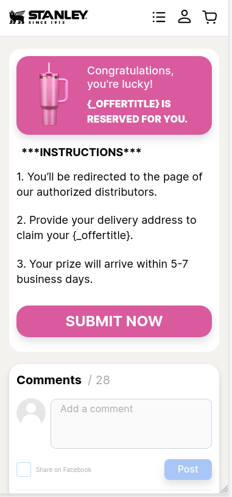
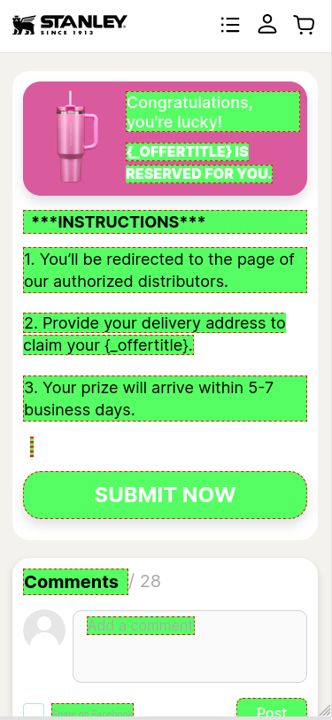

# TranslateDebuger

JavaScript-утилита для отладки переводов на сайте. Позволяет визуально определить, какие элементы переведены, а какие были пропущены, основываясь на классовых префиксах.

---

## ✨ Возможности

* Подсветка всех элементов, участвующих в переводе
* Определение классов без корректного префикса
* Визуальное различие по цветам
* Запуск через терминал или через GET-параметры

<p float="left">
  
  
</p>
---

## 📦 Установка и подключение

1. Скопируйте класс `TranslateDebuger` из `styles_version.js` и вставьте в начало файла `scripts.js`<br>

2. Создайте экземпляр:

PS: waitForTranslation не надо, эта функция уже есть в `scripts.js`

```js
const translate_debuger = new TranslateDebuger()
```

3. Найдите участок, где загружается перевод:

```js
translation = await loadLangData(langCode.toLowerCase());
```

Сразу после добавьте:

```js
translation = await loadLangData(langCode.toLowerCase());
translate_debuger.addAdditionalClasses(Object.keys(translation))
```

> Это позволит отслеживать классы, не начинающиеся с префикса `text_`

4. В `index.html`, **после** подключения `scripts.js`, добавьте:

```html
<!-- В index.html -->
<script src="js/scripts.js?ver=93"></script>
<script>
  translate_debuger.listenGetParamFlag()
</script>
```

---

## 💻 Использование

### 🖥️ Через консоль браузера:

```js
translate_debuger.show()
translate_debuger.hide()
```

`show(colorName)` — принимает 1 параметр цвета (строка):

* `green`
* `red`
* `blue`
* `yellow`

```js
translate_debuger.show("red")
```

### 🔗 Через GET-параметры:

Активируйте дебагер, добавив к URL:

```
https://example.com/?translation_debug=
```

или

```
https://example.com/?translation_debug=blue
```

---

## 📚 Принцип работы

* Все элементы, у которых класс начинается с `text_`, подсвечиваются основным цветом
* Классы, не начинающиеся с префикса `text_`, но переданные через `addAdditionalClasses()`, подсвечиваются более тёмным цветом того же оттенка
* Цвета можно изменять через параметр или в вызове `.show()`

---

## 🔧 Вспомогательные методы

### `addAdditionalClasses(classNames: string[])`

Добавляет список классов, которые не имеют префикса `text_`, но должны быть выделены.

### `listenGetParamFlag()`

Слушает GET-параметры и автоматически включает дебагер при наличии `?translation_debug`

---

## 🧰 Зачем это нужно?

На проектах, где переводы реализованы через классы (например, `text_title`, `text_button`), легко пропустить некоторые элементы. `TranslateDebuger` помогает быстро визуально проверить корректность переводов на всех страницах.

